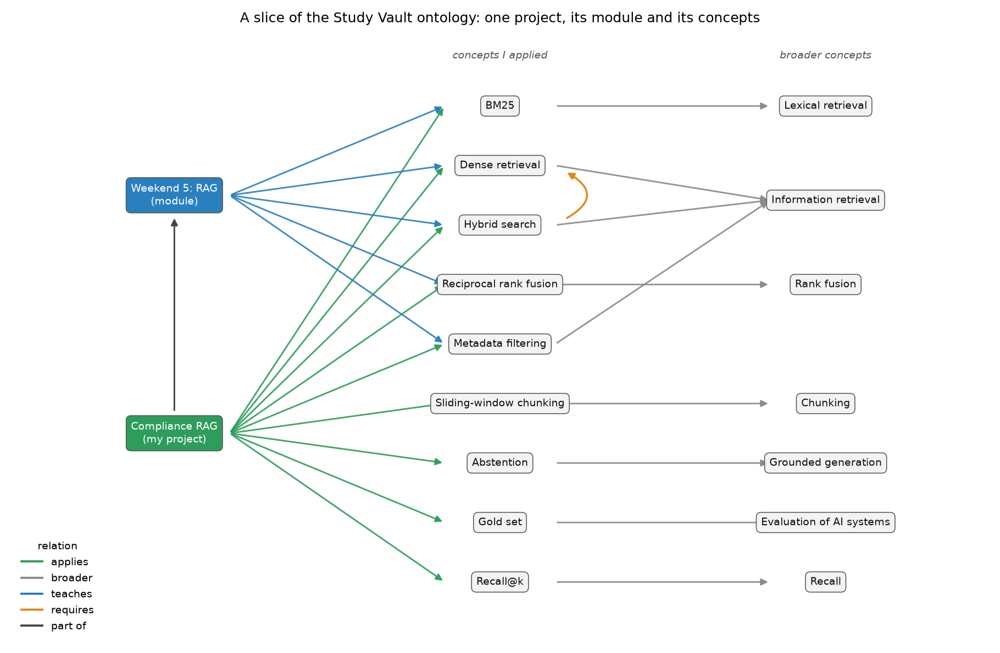
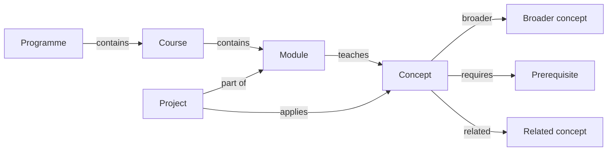
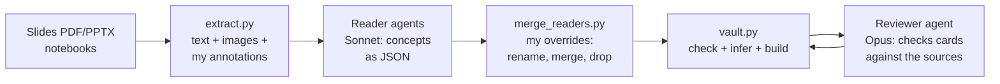

# Study Vault: an ontology of what I study, built for AI agents

**Study Vault** is a domain ontology of my studies at ETH Zurich: a typed knowledge graph of
programmes, courses, modules, **646 concepts** and **18 of my own projects**, with **2,966 typed edges**
between them. It is designed as a retrieval layer for AI agents: instead of embedding my course files
in a vector store, agents navigate a curated, machine-checkable graph.

- **Schema:** five classes (programme, course, module, concept, project) and six typed relations with
  fixed domain and range: `part_of`, `teaches`, `applies`, `requires`, and the SKOS relations
  `broader` and `related` (SKOS is the W3C standard for concept schemes and taxonomies).
- **Integrity constraints:** a validator checks referential integrity, the domain and range of every
  relation, required fields, that every source file exists, and that the `broader` and `requires`
  hierarchies are acyclic.
- **Rule-based inference:** a deterministic reasoner computes the transitive closure of `broader`,
  the inverse relations (narrower, taught in, applied in, required by), prerequisite chains with
  coverage, and taught or applied status propagated up the hierarchy.
- **Provenance:** every assertion points to its evidence, down to the page of a slide deck or the
  notebook of a project, so an agent can cite it and a human can verify it.
- **Serialisation:** one Markdown file per entity with YAML front matter, readable by humans
  (in Obsidian) and by agents, and compiled into a JSON catalog and one-file exports.

I built it for three reasons:

1. **My AI agents should know what I studied.** When I start a new project in Claude Code, the agent
   checks the vault and proposes methods I already learned: "you used hybrid search and reciprocal
   rank fusion in Compliance RAG; the same pattern fits here".
2. **A study companion.** An agent explains a lecture from my own slides, starts from what I already
   covered, and quizzes me.
3. **Honest answers about my skills.** For a CV or an interview, the agent separates what a lecture
   **taught** me from what I **applied** in a project, and says "not recorded" instead of guessing.

  

I am an AI product manager who goes deep into the technical side. I designed the ontology, the
inference rules and the evaluation, and made every trade-off. Claude Code (Claude Opus and Sonnet
agents) did the reading, extraction and coding under my rules, and I checked the results. **The course material belongs to ETH and to me, so this repository shows the method only.**
The vault itself is private; three sample cards are included as an example.

---

## What is in the vault

| | |
|---|---|
| Programmes | 4 (MAS Applied Information and Data Science, two CAS programmes, self-study) |
| Courses | 9 (for example Data Science and ML, AI in Industry, Mobile Computing, AI Product Development) |
| Modules | 22 (teaching blocks or weekends) |
| Concepts | **646**: 264 methods, 243 concepts, 42 domains, 37 tools, 30 metrics, 30 risks |
| Projects | **18** (for example Compliance RAG, delivery routing with reinforcement learning, brain age prediction) |
| Typed links | **2,966** |
| Concepts taught in a lecture | 621 |
| Concepts I applied in a project | 175 |

Every card points to the exact source: `slides.pdf#p13-22` or the project notebook. The raw files stay
where they are; the vault is a map on top of them.

## The ontology

Each card is one Markdown file with typed front matter. There are five card types and six relations:

- `part_of`, `teaches`, `applies` connect my programmes, courses, modules and projects to concepts.
- `broader` and `related` follow **SKOS**, the W3C standard for concept schemes. `requires` marks prerequisites.
- Concepts have a kind: domain, concept, method, metric, tool or risk.

A concept card is short on purpose: one sentence in plain words, then one short paragraph per course
that covered it ("In AI in Industry: ..."), then the sources. See [sample-cards/](sample-cards/).

## Inference: what the vault works out by itself

[`tools/vault.py`](tools/vault.py) checks every card and then computes what follows from the links.
It writes the results into a marked block at the end of each card, so the hand-written part and the
computed part never mix.

- **Checks:** every link points to an existing card of the right type, every source file exists,
  and there are no cycles in `broader` or `requires`.
- **Transitive `broader`:** BM25 → lexical retrieval → information retrieval.
- **Reverse links:** "narrower", "required by", "taught in", "applied in".
- **Taught or applied through narrower concepts:** I never had a lecture called "software engineering",
  but I applied Python, Jupyter and Google Colab in all 18 projects, so the vault knows I have applied it.
- **Prerequisite chains:** all prerequisites of a concept, each marked as covered or not covered.
- **Outputs:** an index with a concept tree, a JSON catalog, one Obsidian canvas per module with
  labelled arrows, and two one-file exports for claude.ai Projects.

I open the folder in **Obsidian** to browse it: the graph view shows the whole network, and the
canvases show each module with its concepts and typed arrows.

## Design choice: an ontology, not GraphRAG or a vector database

The vault is a graph, but it is **not GraphRAG** and uses **no embeddings or vector store**.

- **GraphRAG** lets an LLM extract entities and relations from documents automatically, summarises
  communities of the resulting graph and retrieves over it, usually together with vector search.
  The graph is large, built by the model, and hard to check.
- **Study Vault** has a fixed schema, curated nodes and typed edges that are validated by code and
  reviewed by a second agent, and every edge carries its source. Retrieval is navigation: the agent
  searches card titles, reads the index or a card, and follows typed links. On average it opens
  2.1 files per question, and in evaluation run 4 it found the right card for 28 of 28 questions.

Why this fits here:

| Criterion | Ontology (this project) | GraphRAG or vector search |
|---|---|---|
| Scale | About 700 cards, small enough to curate by hand | Pays off at thousands of documents |
| Precision | "Taught or applied?" is an exact typed relation | Similarity can blur taught and applied |
| Trust | Every edge is checked and points to a page | Edges extracted by a model, hard to verify |
| Cost | No index to build or host; a few small files per question | Embedding, indexing and storage costs |
| Explainability | The agent can show the chain: project → applies → concept → broader | Retrieval scores are hard to explain |

My Weekend 5 course on retrieval said a knowledge graph is not worth it under a few hundred
documents. The vault follows that advice for the *automatic* graph, and keeps a small hand-checked
one instead. If the vault grows a lot, or I need full-text questions over all slides, the next step
would be hybrid search over the raw pages, with the ontology as the metadata filter.

**Obsidian** is only the viewer: I open the folder as an Obsidian vault to browse the graph view and
the module canvases. The ontology does not depend on it; the cards are plain Markdown.

## How the vault was filled

1. **Extract.** [`extract.py`](tools/extract.py) turns each deck into text and keeps page images where
   the text alone loses meaning (diagrams, thin slides). It also keeps **my own annotations** on the
   slides, so the vault knows what I wrote. When a deck exists in several copies, it keeps the one with
   the most annotations.
2. **Separate my work from course text.** For course notebooks kept in a git clone,
   [`extract_notebooks.py`](tools/extract_notebooks.py) compares my working copy with the course
   version, so only the cells I wrote count as my work.
3. **Read.** Reader agents list the main concepts of each course as JSON: name, one-line definition,
   what this course said about it, pages, and links to existing concepts. I asked for main concepts only,
   not every detail.
4. **Merge.** [`merge_readers.py`](tools/merge_readers.py) adds the course's paragraph to existing cards
   and creates new ones. My overrides rename, merge and drop concepts, and fix the hierarchy.
5. **Review.** After every course, a separate reviewer agent (a stronger model, with no stake in the
   result) checks a sample of cards and every project card against the sources. It found real errors:
   wrong page numbers, a number copied wrong, claims that I did something the files do not show.
   I verified the key numbers on every project card myself.

## Skills: the vault in any project

Two Claude Code skills make the vault available in every project on my computer. See [skills/](skills/).

| Skill | Reads | Used for |
|---|---|---|
| [`study-vault`](skills/study-vault/SKILL.md) | Only the short cards, 2-3 per question | Any project: "has she studied X?", "which methods she already learned fit this project?" |
| [`study-companion`](skills/study-companion/SKILL.md) | The cards and then my actual slides and notes | Studying: explain a module from my slides, build on what I covered, quiz me |

The skills use **progressive disclosure**: only a one-line description is always in the agent's
context. The full instructions load when my request matches, and then the agent opens only the
cards it needs. Most projects pay almost nothing for having my whole study history available.

For **claude.ai Projects**, which cannot read local folders, the build writes a compact one-file export
(about 55k tokens) that I add to a project's knowledge.

## Evaluation: can an agent answer from the vault alone?

I tested the vault with **LLM-as-judge**. A fresh agent answers questions about my studies using only the
vault (or only the export), and two judge models score the answers against gold answers that I wrote
from the **raw sources**, not from the cards, so the test does not check the vault against itself.

- **50 questions** of several types: lookups, concept questions, taught or applied, inference over links,
  project facts, multi-hop questions, and trap questions where the right answer is "not recorded".
- **Two judges** (Claude Sonnet and Claude Opus) score independently: 2 = correct, 1 = partly correct,
  0 = wrong or invented. A false claim about me scores 0.
- **Agreement** between the judges (Cohen's kappa) and **retrieval hit rate** (did the agent open the
  card it needed?) are measured by [`score.py`](evaluation/score.py).

| Run | Vault (Claude Code) | One-file export (claude.ai) | What changed |
|---|---|---|---|
| 1 | 89% / 92% (Opus / Sonnet) | 72% / 75% | First course only. Found missing facts in cards and in the export |
| 3 | 100% / 100% (28 questions) | 98% / 98% | After fixes and a second course |
| 4 | 91% / 96% (28 questions) | 88% / 89% (compact export) | Five more courses. Retrieval hit rate 28/28, 2.1 files per question |
| 5 | 4/4 | 4/4 | Re-ask after fixing the four cards that were too thin in run 4 |

Each run fed back into the vault: missing facts were added, one wrong gold answer was corrected when
a judge checked the notebook, and the export now carries lecturers, dates and project facts.
More detail and sample questions: [evaluation/](evaluation/).

## What I learned in my courses, applied to this project

The vault is itself an application of what it describes:

| From my studies | Used here |
|---|---|
| **Graph RAG** "is not worth it under a few hundred documents" (Weekend 5) | No vector database or LLM-built graph. A hand-checked ontology with deterministic inference, and plain search over 700 cards |
| **Metadata filtering** (Weekend 5) | Typed front matter: an agent filters by card type, kind and course before it reads |
| **Progressive disclosure** and **agent skills** (Innovation with GenAI) | Skill description always loaded, body on demand, then only the cards needed |
| **Semantic engineering** (AI Product Development) | One meaning per card, aliases for other words, and standard relation names from SKOS |
| **LLM-as-judge**, **gold sets**, **regression against improvement** (Weekend 5, Innovation with GenAI) | Two judges, gold from raw sources, re-runs after every fix |
| **Abstention** (Mobile Computing, my Grand Finale and Compliance RAG projects) | "Not in the vault means not known": trap questions test that the agent says so |
| **Compounding errors** in multi-step agents (my Mobile Computing assignment: 95% per step gives about 60% over ten steps) | A separate reviewer after every course, and my own check of key numbers |
| **Prompt injection** (Weekend 3, AI in Industry) | Course text is treated as data, never as instructions to the agents |

## Rules I set

- **Nothing invented.** Every fact comes from a source file or from me. When something is uncertain,
  the card says so under "Open points".
- **Taught is not applied.** A lecture covering a topic does not make it a skill.
- **My words stay mine.** My own notes on slides are kept as I wrote them.
- **No personal data, no keys, no classmates' names** in the cards.
- **Course content stays private.** Cards paraphrase in a few sentences; they never copy slides.

## Repository contents

| Folder | What it holds |
|---|---|
| [`tools/`](tools/) | `vault.py` (check, infer, build, merge), `extract.py`, `extract_notebooks.py`, `merge_readers.py` |
| [`templates/`](templates/) | The five card templates |
| [`skills/`](skills/) | The two Claude Code skills |
| [`sample-cards/`](sample-cards/) | Three cards as they look after the build, and an example `roots.json` |
| [`evaluation/`](evaluation/) | Method, results, sample questions and the scoring script |

**Stack:** Markdown + YAML front matter · Python (PyYAML, PyMuPDF) · Obsidian for browsing ·
Claude Code with Claude Opus and Sonnet sub-agents · about 7 million tokens of agent work for 9 courses.
